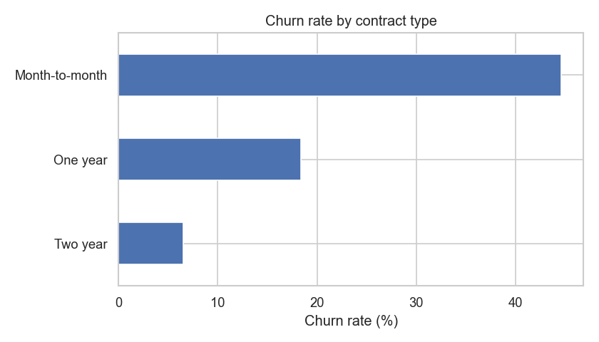
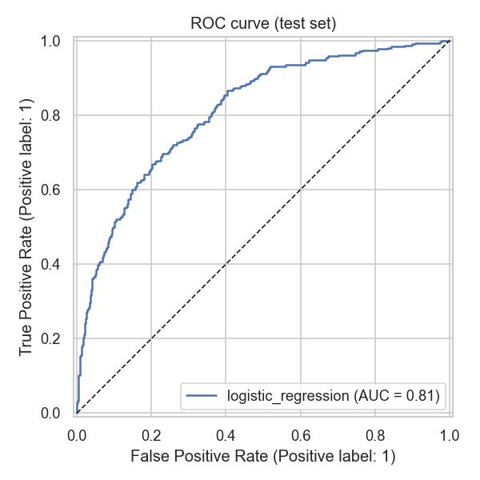

# Customer Churn Prediction

An end-to-end data science project in Python: generate a telecom customer dataset,
explore it, and train machine-learning models that predict which customers will
cancel their service (churn).

## What it does

1. **Data**: builds a synthetic dataset of 5,000 customers (tenure, contract, internet
   service, payment method, charges, support calls) with ~1% missing values
   (`src/churn/data.py`).
2. **EDA**: summary stats plus charts saved to `reports/figures/` (`src/churn/eda.py`).
3. **Modeling**: a scikit-learn pipeline (imputation, scaling, one-hot encoding)
   compares Logistic Regression, Random Forest and Gradient Boosting with 5-fold
   cross-validated ROC-AUC. It then evaluates the best model on a held-out test set
   and saves it to `models/churn_model.joblib` (`src/churn/model.py`).

## Results (default run)

| Metric | Value |
|---|---|
| Churn rate | 30.7% |
| Best model | Logistic Regression |
| Test ROC-AUC | 0.813 |
| Test accuracy | 0.779 |
| Test F1 | 0.585 |

Month-to-month customers churn at **44.6%**, compared with **6.5%** on two-year contracts.




## Run it

```bash
pip install -r requirements.txt
python main.py            # options: --rows 10000 --seed 1
python -m pytest -q
```

Outputs: `data/customers.csv`, `reports/metrics.json`, `reports/figures/*.png`,
`models/churn_model.joblib`.

## Project layout

```
churn-prediction/
├── main.py              # runs the whole pipeline
├── src/churn/
│   ├── data.py          # synthetic data generator
│   ├── eda.py           # summaries and plots
│   ├── features.py      # preprocessing pipeline
│   └── model.py         # training, CV, evaluation
├── tests/               # pytest suite
├── reports/             # metrics + figures
├── data/  models/       # generated (git-ignored)
└── requirements.txt
```
